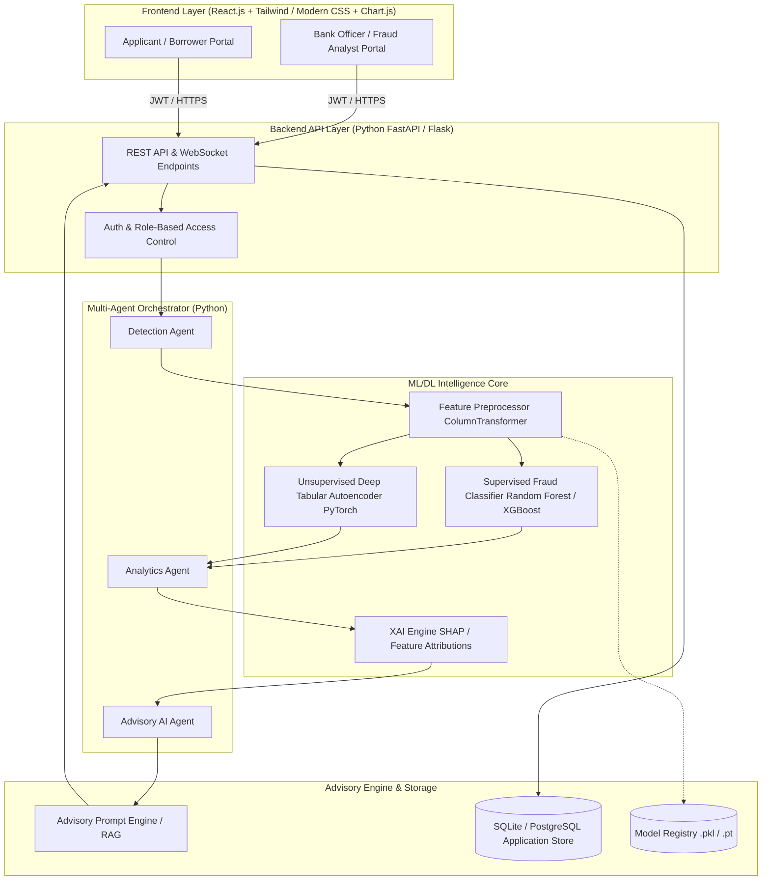
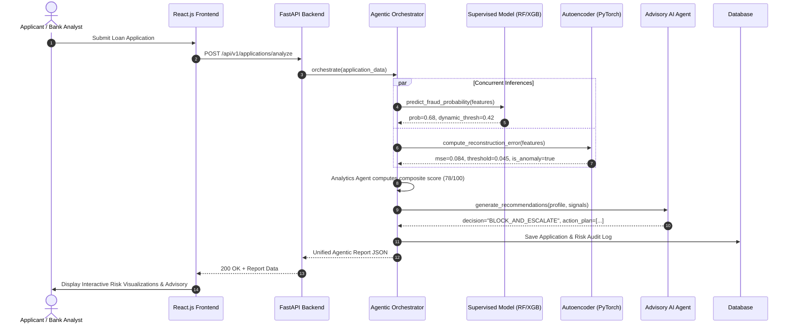
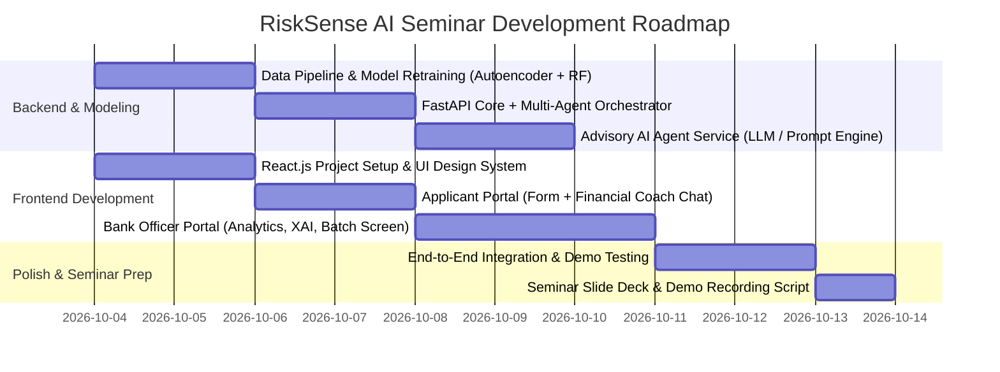

# Software Requirements Specification (SRS) & Seminar Development Plan
## RiskSense AI: Agentic Banking Fraud Analytics & Advisory Platform

**Project Title:** RiskSense AI – Dual-Portal Banking Fraud Detection & AI Advisory System  
**Course/Event:** Deep Learning & AI Seminar / Capstone  
**Target Architecture:** React.js (Frontend) + Python FastAPI/PyTorch (Backend & ML/DL Engine) + Multi-Agent Advisory Framework  

---

## Part 1: Executive Overview & Seminar Development Blueprint

### 1.1 Project Vision
**RiskSense AI** is a next-generation financial fraud analytics platform combining:
1. **Supervised Classification (Random Forest / XGBoost / Ensemble)** to detect known fraud patterns from historical labeled applications.
2. **Deep Tabular Autoencoder (PyTorch)** trained strictly on genuine applications to learn normal borrower manifolds and flag novel/zero-day fraud anomalies via reconstruction error.
3. **Multi-Agent Orchestration System** comprising:
   - **Detection Agent**: Executes concurrent model inference.
   - **Analytics Agent**: Integrates rule-based financial risk heuristics (CIBIL, DTI, LTV, EMI burden).
   - **Advisory AI Agent**: LLM-backed (or rule/retrieval-grounded) copilot providing explainable audit narratives, fraud mitigating recommendations for bank officers, and credit-health optimization advice for loan applicants.
4. **Dual Persona Portals**:
   - **Bank Fraud Officer / Underwriter Portal**: Detailed risk metrics, SHAP/feature attribution, anomaly reconstruction visualizations, batch screening, case audit workflows, and sanction controls.
   - **Customer / Loan Applicant Portal**: Transparent loan application submission, instant pre-qualification feedback, financial health tips, and conversational advisory on how to improve eligibility and rectify risk flags.

---

### 1.2 System Architecture Diagram



---

### 1.3 Key Corrections & Advancements over Baseline KT Document

1. **Resolution of Debt-to-Income (DTI) Scale Inconsistency**: Standardize DTI into a percentage (`0% - 100%`) or clean ratio across all forms, API contracts, rules, and model preprocessors.
2. **True Generalization & Train-Test Rigor**: Ensure 80/20 stratified split before SMOTE to prevent data leakage, evaluating with Precision-Recall AUC (PR-AUC), ROC-AUC, and F1-score.
3. **Advanced Tabular Autoencoder**:
   - Architecture: Input (28) -> Dense(32, ReLU) -> BatchNorm -> Dense(16, ReLU) -> Bottleneck(8) -> Dense(16, ReLU) -> BatchNorm -> Dense(32, ReLU) -> Output(28).
   - Loss: MSE with dynamic quantile thresholding (97.5th percentile on genuine validation set).
4. **Interactive Advisory Agent**: Transition from static keyword matching to a contextual conversational assistant (using OpenAI / Gemini / Ollama / Llama-3 / LangChain or smart structured JSON prompt engineering) with strict guardrails.
5. **Modern Tech Stack Transition**: Upgrade frontend from vanilla server-side Jinja templates to **React.js (Vite + Modern UI)** with rich charts (reconstruction error distributions, radar risk charts, SHAP waterfall plots), backed by **FastAPI** for asynchronous high-throughput inference.

---

## Part 2: Software Requirements Specification (SRS)

### 1. Introduction

#### 1.1 Purpose
This document specifies the software requirements for the **RiskSense AI** Loan Fraud Detection & Advisory Platform. It serves as the authoritative blueprint for developers, ML engineers, domain evaluators, and seminar reviewers.

#### 1.2 Scope
RiskSense AI automates fraud risk assessment during digital loan originations. It ingests borrower application data, runs concurrent supervised and unsupervised deep learning models, aggregates signals via an agentic pipeline, generates explainable risk reports, and facilitates automated advisory interactions for both bank personnel and borrowers.

#### 1.3 Definitions, Acronyms, and Abbreviations
- **AE**: Autoencoder (Deep Neural Network for unsupervised representation learning).
- **AUC-ROC**: Area Under the Receiver Operating Characteristic curve.
- **CIBIL**: Credit Information Bureau (India) Limited credit score (range 300–900).
- **DTI**: Debt-to-Income Ratio.
- **EMI**: Equated Monthly Installment.
- **LTV**: Loan-to-Value or Loan-to-Income ratio.
- **MSE**: Mean Squared Error.
- **SMOTE**: Synthetic Minority Over-sampling Technique.
- **XAI**: Explainable Artificial Intelligence (e.g., SHAP, feature importance).

---

### 2. Overall Description

#### 2.1 Product Perspective
RiskSense AI operates as a cloud-native or local microservice architecture consisting of a React.js single-page application communicating via RESTful APIs with a Python backend powered by PyTorch, Scikit-Learn, and an AI Advisory reasoning engine.

#### 2.2 User Classes and Characteristics
1. **Bank Fraud Analyst / Underwriter**:
   - Technical proficiency: Medium-High.
   - Goals: Inspect high-risk loan applications, review autoencoder anomaly signals, analyze SHAP feature attributions, request field verifications, approve/reject/escalate applications.
2. **Loan Applicant / Borrower**:
   - Technical proficiency: Low-Medium.
   - Goals: Submit loan applications, receive instant status updates, view transparent explanations for review delays, receive personalized financial health advisory from the AI agent.
3. **System Administrator / Auditor**:
   - Goals: Monitor model drift, inspect audit logs, adjust dynamic risk thresholds, upload batch test files.

#### 2.3 Operating Environment
- **Client**: Modern web browsers (Chrome 110+, Edge, Firefox, Safari).
- **Backend Server**: Python 3.10+ on Linux/Windows/Docker container.
- **Hardware Acceleration**: CPU-optimized inference (PyTorch TorchScript / ONNX optional for sub-10ms response).

---

### 3. System Features and Functional Requirements



#### 3.1 Applicant Application Submission & Self-Service Portal
- **FR-APP-01**: The system shall provide an intuitive, multi-step application form capturing:
  - Loan Details: Amount requested, tenure, loan type, purpose of loan.
  - Financial Profile: Monthly income, existing monthly EMIs, property ownership status.
  - Personal Details: Age, gender, dependents, employment status, residential address, CIBIL score.
- **FR-APP-02**: The system shall perform real-time client-side validation (e.g., DTI computation, numeric range boundaries).
- **FR-APP-03**: The applicant shall receive a customer-friendly summary explaining the application status without revealing proprietary detection heuristics.
- **FR-APP-04**: The applicant portal shall include a **Borrower Financial Coach (Advisory AI)** providing tips to improve creditworthiness if flagged for review.

#### 3.2 Machine Learning & Deep Learning Detection Engine
- **FR-ML-01 (Feature Engineering & Preprocessing)**: The backend shall transform raw inputs via a standardized `ColumnTransformer` (StandardScaler for 9 numeric columns, OneHotEncoder for 5 categorical columns) producing a 28-dimensional dense vector.
- **FR-ML-02 (Supervised Fraud Probability)**: The system shall run a pre-trained Random Forest/XGBoost classifier to calculate raw probability $P(\text{fraud} \mid x)$.
- **FR-ML-03 (Dynamic Threshold Calculation)**: The system shall dynamically compute an applicant-specific threshold:
  $$\text{Threshold} = \text{clamp}\Big(0.40 - \Delta_{\text{cibil}} + \Delta_{\text{dti}} + \Delta_{\text{emi}}, [0.20, 0.60]\Big)$$
- **FR-DL-01 (Unsupervised Deep Autoencoder)**: The PyTorch Autoencoder shall reconstruct the 28-dimensional vector:
  $$\text{Loss}_{\text{MSE}} = \frac{1}{D} \sum_{i=1}^{D} (x_i - \hat{x}_i)^2$$
- **FR-DL-02 (Anomaly Flagging)**: If $\text{Loss}_{\text{MSE}} > \tau_{97.5}$, the system shall trigger `is_anomaly = True` and compute individual feature reconstruction errors for explainability.

#### 3.3 Multi-Agent Orchestration & Analytics Engine
- **FR-AG-01 (Detection Agent)**: Wraps model execution, execution timing, and raw signal packaging.
- **FR-AG-02 (Analytics Agent - Rule Engine)**: Integrates 7 key domain rules to calculate a normalized 0–100 composite risk score:
  - CIBIL score checks (< 600 triggers Critical alert, 600–675 Moderate).
  - High DTI ratio (> 45% adds +15 points).
  - High Loan-to-Income / EMI burden (> 50% income adds +12 points).
  - High Autoencoder Reconstruction Error (+15 points).
  - Unstable employment / young age combined with high ticket loan (+10 points).
- **FR-AG-03 (Risk Categorization)**:
  - **Critical (70–100)**: Immediate Block & Escalate.
  - **High (45–69)**: Enhanced Manual Due Diligence.
  - **Moderate (25–44)**: Secondary Verification / Field Visit.
  - **Low (0–24)**: Standard Fast-Track Approval.

#### 3.4 Conversational Advisory AI Agent
- **FR-ADV-01 (Bank Officer Copilot)**:
  - Explain root causes of anomalies ("Why was this flagged?").
  - Suggest verification checklists (e.g., "Verify ITR V-form, inspect bank statement for salary credits").
  - Draft sanction or clarification letters.
- **FR-ADV-02 (Applicant Advisor)**:
  - Answer borrower questions ("Why do I need manual review?").
  - Provide constructive advice ("Reducing loan tenure from 60 to 36 months lowers your debt-burden risk").
- **FR-ADV-03 (Guardrails & Context-grounding)**: The Advisory agent shall never hallucinate financial facts and must ground answers strictly on the application's computed risk report.

#### 3.5 Bank Officer Dashboard & Batch Screening
- **FR-DSH-01**: Executive summary dashboard displaying total volume, fraud detection rate, average anomaly score, and risk tier distribution.
- **FR-DSH-02 (Batch Screening)**: Support uploading bulk CSV files (e.g., 500+ records) with asynchronous processing, progress indicators, and downloadable risk-audited CSV.
- **FR-DSH-03 (Case Management & Audit Trail)**: Workflow allowing analysts to mark status (`Under Review`, `Approved`, `Flagged as Fraud`, `Documents Requested`), attach notes, and export PDF compliance reports.

---

### 4. Non-Functional Requirements

#### 4.1 Performance & Latency
- **NFR-01**: Real-time single application analysis (ML + DL + Rules) response time must be $< 150\text{ ms}$ on standard server hardware.
- **NFR-02**: Advisory Agent response streaming must start within $< 1.2\text{ s}$.
- **NFR-03**: Batch processing must handle at least 50 records/second.

#### 4.2 Security, Privacy & Compliance
- **NFR-04 (PII Protection)**: Residential address, customer IDs, and names must be masked in analytical logs.
- **NFR-05 (Authentication)**: JWT-based authentication with Role-Based Access Control (`ROLE_ANALYST`, `ROLE_CUSTOMER`, `ROLE_ADMIN`).
- **NFR-06 (Audit Logging)**: All manual overrides and final approval decisions must be immutable and timestamped.

#### 4.3 Reliability & Graceful Degradation
- **NFR-07**: If the Autoencoder model artifact is offline, the system must continue operating in degraded mode (supervised + heuristic rules) while notifying the officer of missing deep anomaly signals.

---

## Part 3: Seminar Presentation & Live Demo Plan

### 3.1 Seminar Narrative & The "Hook"
1. **The Core Problem**: Why traditional bank credit scorecards fail when organized fraud syndicates submit synthetic identities with clean-looking credit records.
2. **The Innovation**: Combining **Supervised ML** (detects historical known frauds) + **Unsupervised Deep Autoencoder** (detects previously unseen anomaly manifolds) + **Agentic Advisory AI** (bridges math to human decision-making).
3. **The Methodological Honesty (Academic Merit)**: Showcasing real data engineering discipline: exposing train-vs-test overestimation, evaluating with PR-AUC/ROC-AUC, and demonstrating how multi-agent rules stabilize imperfect ML predictions.

### 3.2 10-Minute Live Demo Walkthrough Script

| Time | Phase | Action / Screen | Key Talking Point |
|---|---|---|---|
| **00:00 - 02:00** | Introduction | Problem Slides + Architecture Overview | The dual-threat of loan fraud: false negatives cost millions; false positives lose genuine customers. |
| **02:00 - 04:30** | Applicant Experience | React Applicant Portal (`/apply`) | Submit an application. Show how the applicant gets real-time pre-assessment and interacts with the AI Financial Advisor. |
| **04:30 - 07:30** | Bank Analyst Experience | React Analyst Dashboard (`/analyst/cases`) | Inspect the flagged application. Demonstrate the **Autoencoder Reconstruction Error chart**, **SHAP feature breakdown**, and query the **Bank Copilot AI** ("Why was this high risk?"). |
| **07:30 - 09:00** | Batch Screening & Deep Dive | Batch Screener (`/analyst/batch`) | Upload 1,000 application CSV records; instant scatter plot of supervised probability vs. autoencoder anomaly error. |
| **09:00 - 10:00** | Q&A & Conclusion | Architecture & Evaluation Slide | Highlight modularity, graceful degradation, and production readiness. |

---

## Part 4: Technical Implementation Roadmap



### 4.1 Recommended Folder Structure
```text
Loan Project/
├── backend/
│   ├── app/
│   │   ├── api/
│   │   │   ├── endpoints/          # /analyze, /batch, /advisor, /auth, /cases
│   │   │   └── api_router.py
│   │   ├── agents/
│   │   │   ├── orchestrator.py     # Central Multi-Agent pipeline
│   │   │   ├── detection_agent.py  # Model inference wrapper
│   │   │   ├── analytics_agent.py  # Rule engine & composite risk score
│   │   │   └── advisory_agent.py   # LLM/Conversational engine
│   │   ├── ml/
│   │   │   ├── autoencoder.py      # PyTorch Autoencoder definition
│   │   │   ├── predictor.py        # Supervised classifier wrapper
│   │   │   └── xai.py              # SHAP / Feature attribution
│   │   ├── core/                   # Config, security, database
│   │   ├── models/                 # Pydantic schemas & DB models
│   │   └── main.py                 # FastAPI application entry
│   ├── artifacts/                  # Saved .pkl, .pt, preprocessor files
│   ├── train_pipeline.py           # Clean train/val pipeline with no leakage
│   └── requirements.txt
├── frontend/
│   ├── src/
│   │   ├── components/             # Reusable UI (Navbar, GlassCard, Charts, Badges)
│   │   ├── pages/
│   │   │   ├── applicant/          # Application Form, Status Tracker, Borrower Chat
│   │   │   └── bank/               # Officer Dashboard, Case Details, Batch Screener, Copilot
│   │   ├── services/               # Axios API client
│   │   ├── context/                # Auth & Theme State
│   │   └── App.jsx
│   ├── package.json
│   └── tailwind.config.js / index.css
└── docs/
    ├── SRS.md
    └── SEMINAR_PITCH.md
```
